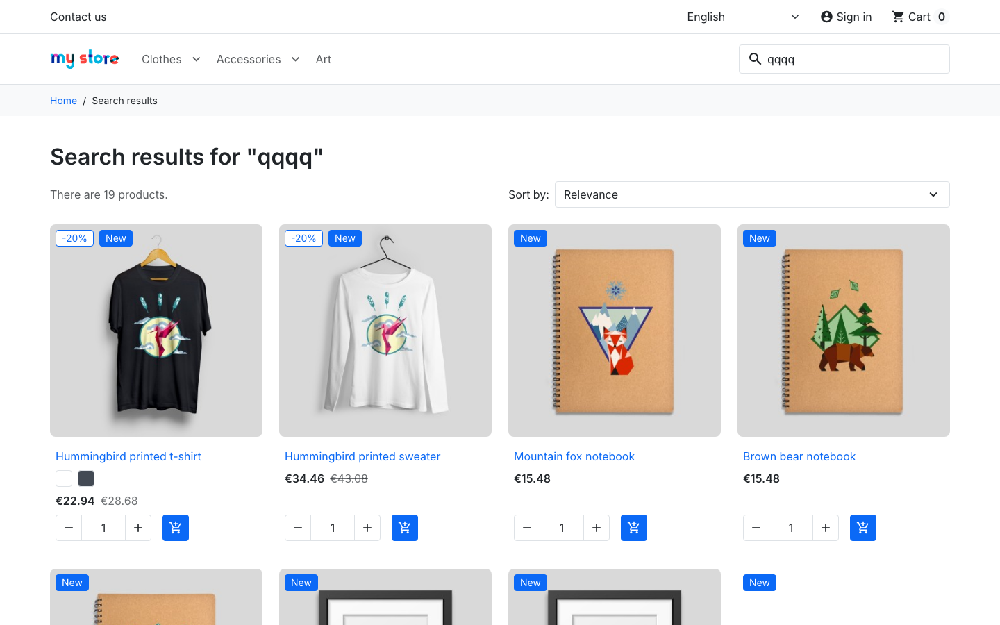

# BUG-001 · Search returns unrelated products for words that match nothing

| Field | Value |
|---|---|
| Type | Configuration (most likely): fuzzy search set far too tolerant, see Notes |
| Severity | **Major** |
| Priority | High |
| Area | Shop › Search (header search box and search results page) |
| Environment | demo.prestashop.com, PrestaShop 9 / Hummingbird, Chromium + WebKit |
| Reproducible | Always |
| Found by | Exploratory testing; automated as `TC-SEARCH-04` in [`ui/tests/search.spec.ts`](../ui/tests/search.spec.ts) |

## Summary

Searching for a word that no product contains should say "No search results". Instead the shop shows a list of unrelated products. For example, `qqqq` returns 12 of the 19 products in the catalogue.

## Steps to reproduce

1. Open the shop.
2. Type `qqqq` in the search box at the top of the page and press Enter.

## Expected result

- The heading says **No search results for "qqqq"**.
- No products are listed. (This is what already happens for `zz`, `%` or `"`.)

## Actual result

The heading says **Search results for "qqqq"** and 12 products are listed, none of which contain "qqqq":

> Hummingbird printed t-shirt, Hummingbird printed sweater, Mountain fox notebook, Brown bear notebook, Hummingbird notebook, The best is yet to come' Framed poster, The adventure begins Framed poster, Today is a good day Framed poster, Mountain fox cushion, Brown bear cushion, Hummingbird cushion, Mug The best is yet to come

Other examples:

| Search word | Products shown |
|---|---|
| `asdfgh` | Mug Today is a good day, Mountain fox cushion, Brown bear cushion, Hummingbird cushion |
| `xyz123` | Mountain fox notebook, Brown bear notebook, Hummingbird notebook |
| `zzzqqq` | Mountain fox – Vector graphics, Brown bear – Vector graphics, Hummingbird – Vector graphics |
| `<b>bold</b>` | Mug Today is a good day, Today is a good day Framed poster, Pack Mug + Framed poster |

## Evidence

## Impact

- Customers looking for something the shop does not sell are shown random products instead of a clear "we don't have that".
- This hides real "no result" searches from the shop owner's search statistics.

## Notes

The pattern suggests the *fuzzy search* (approximate word matching) tolerates far too many differences: any word gets "corrected" to some indexed word. Check the fuzzy-search settings (*Shop Parameters › Search*) and the maximum allowed word distance.

Fuzzy search itself is intended: it lets small typos still find the right product. So this is most likely a setting rather than a code defect. The setting goes too far, though: any word matches something, while very short words like `zz` correctly return nothing.
