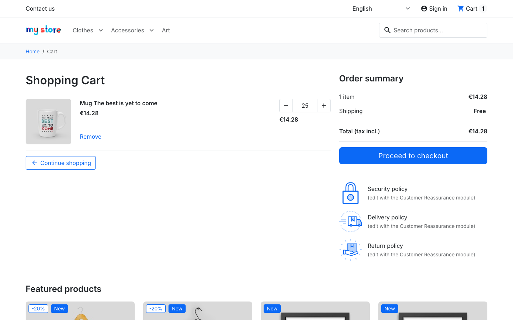
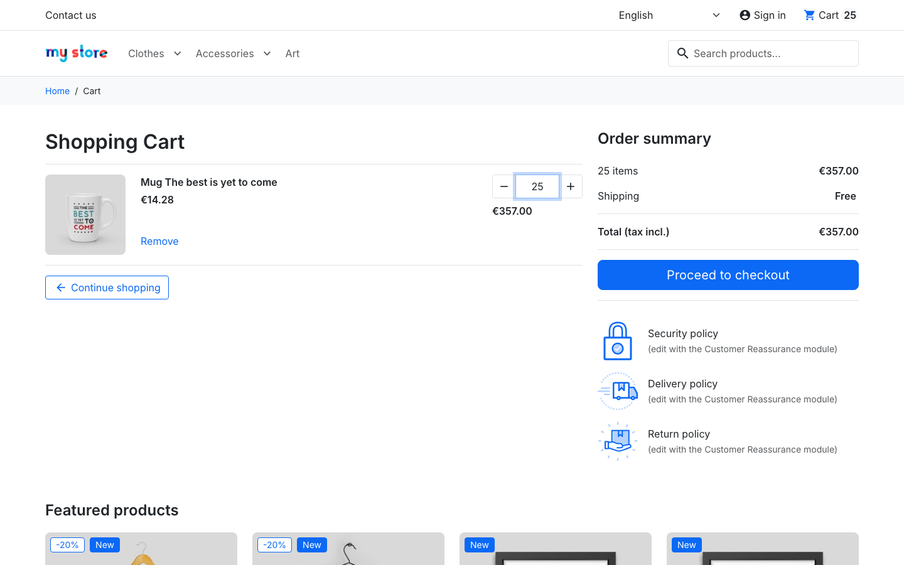

# BUG-002 · Quantity "2.5" in the cart becomes 25 items

| Field | Value |
|---|---|
| Type | Defect |
| Severity | **Major** (customer can order and pay for 10× more than intended) |
| Priority | High |
| Area | Shop › Cart › quantity field |
| Environment | demo.prestashop.com, PrestaShop 9 / Hummingbird, Chromium + WebKit |
| Reproducible | Always |
| Found by | Exploratory testing; automated as `TC-CART-09` (with `2.5` and `2,5`) in [`ui/tests/cart.spec.ts`](../ui/tests/cart.spec.ts) |

## Summary

When a decimal quantity is typed in the cart, the separator is silently removed: `2.5` and `2,5` both become **25**. The cart, the total and the header counter all update to 25 items, and no message is shown.

## Steps to reproduce

1. Open the product **Mug The best is yet to come** (€14.28) and click **Add to cart**.
2. Open the cart.
3. In the quantity field of the mug, replace `1` with `2.5` and press Enter.

## Expected result

One of these:

- The value is refused with a message such as "Please enter a whole number" and the quantity stays 1.
- The value is rounded down to 2.

The quantity must never be larger than what the customer typed.

## Actual result

- Quantity: **25**
- Total: **€357.00** (25 × €14.28)
- Header cart counter: **25**
- No message is shown.

The same happens to every character that is not a digit. Checked on 26 Oct 2026 in Chromium and WebKit, each time starting from 1 mug; both browsers gave the same result, and no message was shown:

| Typed | Saved in the cart |
|---|---|
| `2.5` | 25 |
| `2,5` (decimal comma) | 25 |
| `2 5` | 25 |
| `1e1` | 11 |
| `3a` | 3 |
| `-3` | 3 ([BUG-003](BUG-003.md)) |

## Evidence

| Typed | After pressing Enter |
|---|---|
|  |  |

## Impact

A customer who types a decimal by mistake, or out of habit, ends up with ten times the quantity. If they don't notice it on the cart or checkout summary, they pay for it, and the shop then has to deal with returns and refunds.

## Notes

- **Cause, seen in the browser:** the page's script removes every character that is not a digit and only then sends the change. For `2.5`, the request to the server already says `op=up`, `qty=24` (1 + 24 = 25), so the server never sees the decimal. The field declares digits only (`pattern="[0-9]+"`), but the script does not reject values that break that rule.
- Related: [BUG-003](BUG-003.md) (negative numbers).
