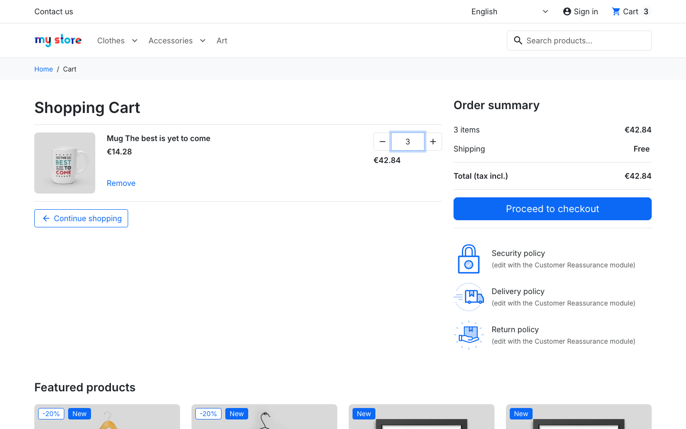

# BUG-003 · Negative quantity "-3" in the cart becomes 3 items

| Field | Value |
|---|---|
| Severity | Minor |
| Priority | Medium |
| Area | Shop › Cart › quantity field |
| Environment | demo.prestashop.com, PrestaShop 9 / Hummingbird, Chromium + WebKit |
| Reproducible | Always |
| Found by | Exploratory testing; automated as `TC-CART-10` in [`ui/tests/cart.spec.ts`](../ui/tests/cart.spec.ts) |

## Summary

A negative quantity is not rejected: the minus sign is dropped and `-3` is saved as **3** items.

## Steps to reproduce

1. Add **Mug The best is yet to come** to the cart (quantity 1).
2. Open the cart.
3. In the quantity field, type `-3` and press Enter.

## Expected result

The value is refused with a message, and the quantity stays 1.

## Actual result

The quantity changes to **3**, the total to **€42.84**, and the header counter to **3**. No message is shown.

## Evidence

## Notes

Same cause as [BUG-002](BUG-002.md): non-digit characters are stripped instead of the input being validated. Other invalid values behave well: `0` and `abc` reset to 1, and `99999` is capped at the stock with a clear message (covered by `TC-CART-08`).
