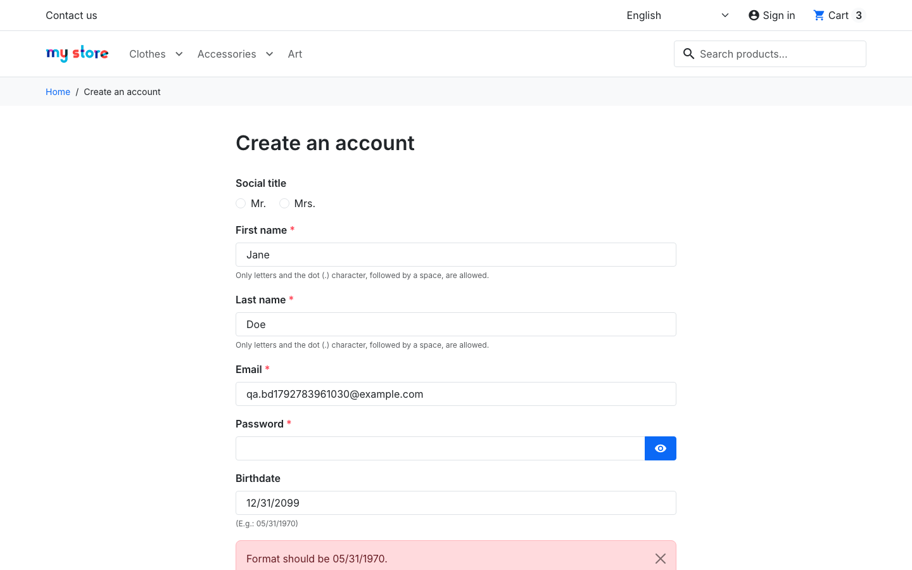

# BUG-004 · Future birth date is rejected with a misleading "Format should be…" message

| Field | Value |
|---|---|
| Type | Defect (misleading message) |
| Severity | Minor |
| Priority | Low |
| Area | Shop › Create an account (also the guest form in checkout) |
| Environment | demo.prestashop.com, PrestaShop 9 / Hummingbird, Chromium + WebKit |
| Reproducible | Always |
| Found by | Exploratory testing; automated as `TC-LOGIN-11` in [`ui/tests/login.spec.ts`](../ui/tests/login.spec.ts) |

## Summary

A birth date in the future is correctly refused, but the error message says the *format* is wrong. The format is exactly the one the page asks for, so the user can't tell what to fix.

## Steps to reproduce

1. Open **Create an account**.
2. Fill in first name, last name, email and a valid password.
3. In **Birthdate**, type `12/31/2099`. This matches the requested format MM/DD/YYYY.
4. Tick the two required consent boxes and click **Create account**.

## Expected result

A message that names the real problem, e.g. **"The birth date cannot be in the future."**

## Actual result

The account is not created (correct), and the message says **"Format should be 05/31/1970."** The password field is also cleared, so the user has to type it again.

For comparison, `05/31/1970` is accepted (`TC-LOGIN-12`).

## Evidence

## Impact

Users try other date formats in vain and may give up on registering. It's low impact because the field is optional and can be left empty.
