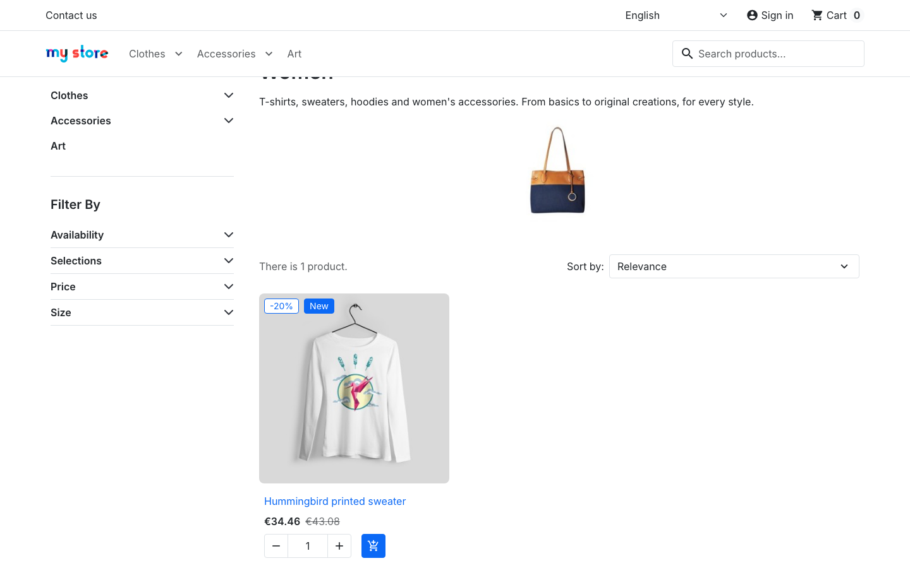

# BUG-005 · "Hummingbird printed sweater" has the image text and URL of "Brown bear printed sweater"

| Field | Value |
|---|---|
| Type | Defect (catalogue data) |
| Severity | Minor |
| Priority | Medium |
| Area | Shop › Catalogue data (product lists, product page) |
| Environment | demo.prestashop.com, PrestaShop 9 / Hummingbird, all browsers |
| Reproducible | Always |
| Found by | Accessibility snapshot while exploring; automated as `TC-SEARCH-11` in [`ui/tests/search.spec.ts`](../ui/tests/search.spec.ts) |

## Summary

The product is called **Hummingbird printed sweater**, but its picture is described as **"Brown bear printed sweater"** (the image `alt` text) and its web address is `/2-9-brown-bear-printed-sweater.html`.

## Steps to reproduce

1. Open **Clothes › Women**, or look at **Featured products** on the cart page.
2. Look at the sweater: its title says *Hummingbird printed sweater*.
3. Hover over or inspect the image, or the link: the image text says *Brown bear printed sweater*, and the link goes to `…/2-9-brown-bear-printed-sweater.html`.

## Expected result

Title, image description and URL all describe the same product: *Hummingbird printed sweater*, `…-hummingbird-printed-sweater.html`.

## Actual result

| Where | Value |
|---|---|
| Product title | Hummingbird printed sweater |
| Image description (`alt`) | Brown bear printed sweater |
| URL | `/2-9-brown-bear-printed-sweater.html` |

## Evidence

## Impact

- **Accessibility:** screen-reader users hear the name of a different product.
- **Shared links and search engines** show "brown-bear" for a hummingbird product.

## Notes

The mismatch comes from PrestaShop's own demo catalogue, which the installer adds to every new demo shop. Checked in the PrestaShop source code (branch 9.2.x, 26 Oct 2026):

- [`product.xml`](https://github.com/PrestaShop/PrestaShop/blob/eb3737c5abda2da259ff471b85159512fd124fb7/install-dev/fixtures/fashion/langs/en/data/product.xml#L14-L20): the product named *Hummingbird printed sweater* has the URL name `brown-bear-printed-sweater`.
- [`image.xml`](https://github.com/PrestaShop/PrestaShop/blob/eb3737c5abda2da259ff471b85159512fd124fb7/install-dev/fixtures/fashion/langs/en/data/image.xml#L63-L64): its image has the caption *Brown bear printed sweater*.

So the fix belongs in PrestaShop's demo data. A shop that already has the product can correct its friendly URL and image caption on the product page in the back office.
