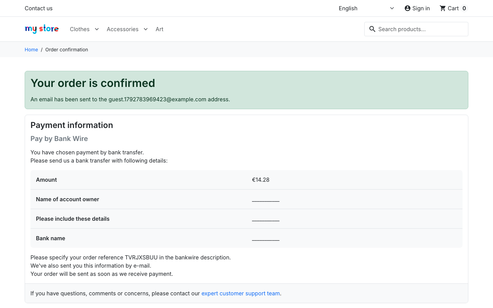

# BUG-006 · Bank-wire payment instructions show blank placeholders instead of bank details

| Field | Value |
|---|---|
| Severity | **Major** (in a real shop the customer cannot pay) |
| Priority | Medium (configuration fix) |
| Area | Shop › Checkout › Payment "Pay by bank wire" and order confirmation |
| Environment | demo.prestashop.com, PrestaShop 9 / Hummingbird, all browsers |
| Reproducible | Always |
| Found by | Exploratory testing during the checkout flow; automated as `TC-CHK-06` in [`ui/tests/checkout.spec.ts`](../ui/tests/checkout.spec.ts) |

## Summary

After an order is placed with **Pay by bank wire**, the confirmation page tells the customer to send a bank transfer. Instead of the shop's account details, it shows `___________` lines.

## Steps to reproduce

1. Add any product to the cart and go to checkout.
2. Complete personal information, address and shipping.
3. Choose **Pay by bank wire**, accept the terms and click **Place Order**.
4. Look at **Payment information** on the confirmation page.

## Expected result

The real details: name of the account owner, bank details (IBAN/BIC) and bank name. If they are not configured, the bank-wire option should not be offered at all.

## Actual result

| Field | Shown |
|---|---|
| Amount | €14.28 |
| Name of account owner | `___________` |
| Please include these details | `___________` |
| Bank name | `___________` |

## Evidence

The payment step that leads to it: [BUG-006-payment-step.png](assets/BUG-006-payment-step.png)

## Notes

- **Cause, checked in the source code of the *Bank wire* module** ([`ps_wirepayment.php`, lines 255–274](https://github.com/PrestaShop/ps_wirepayment/blob/15087446c9ac3129983022d06b8ef4051a90a32c/ps_wirepayment.php#L255-L274)): the confirmation page shows `___________` whenever the account owner, account details or bank address setting is empty. So this is a configuration gap (*Payment › Payment methods › Bank wire › Configure*). It's understandable on a demo, but it's a release blocker for a real shop.
- The order email is filled from the same three settings ([lines 88–90](https://github.com/PrestaShop/ps_wirepayment/blob/15087446c9ac3129983022d06b8ef4051a90a32c/ps_wirepayment.php#L88-L90)), without the `___________` fallback, so its bank details are empty as well. This comes from the code, because the demo shop sends no emails.
