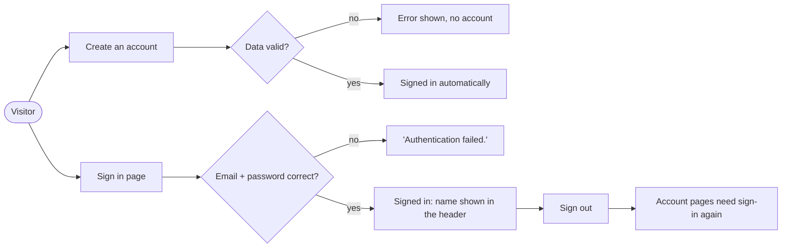
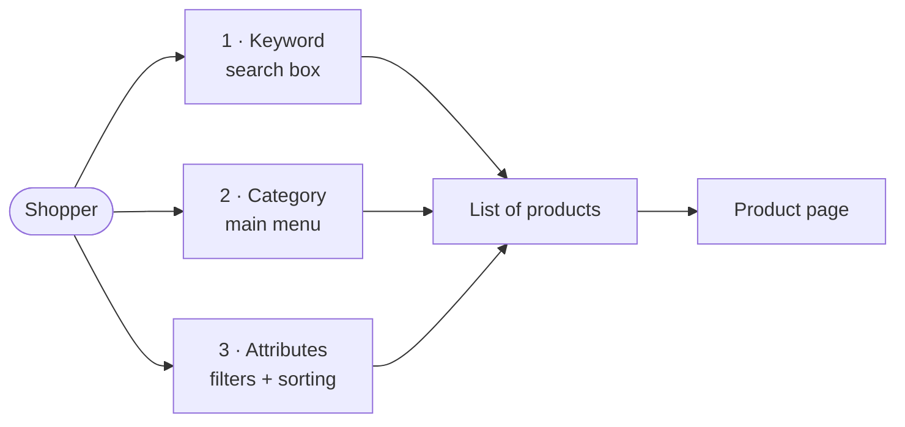
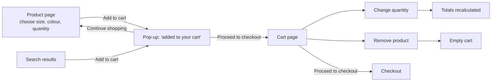
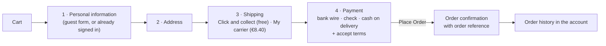
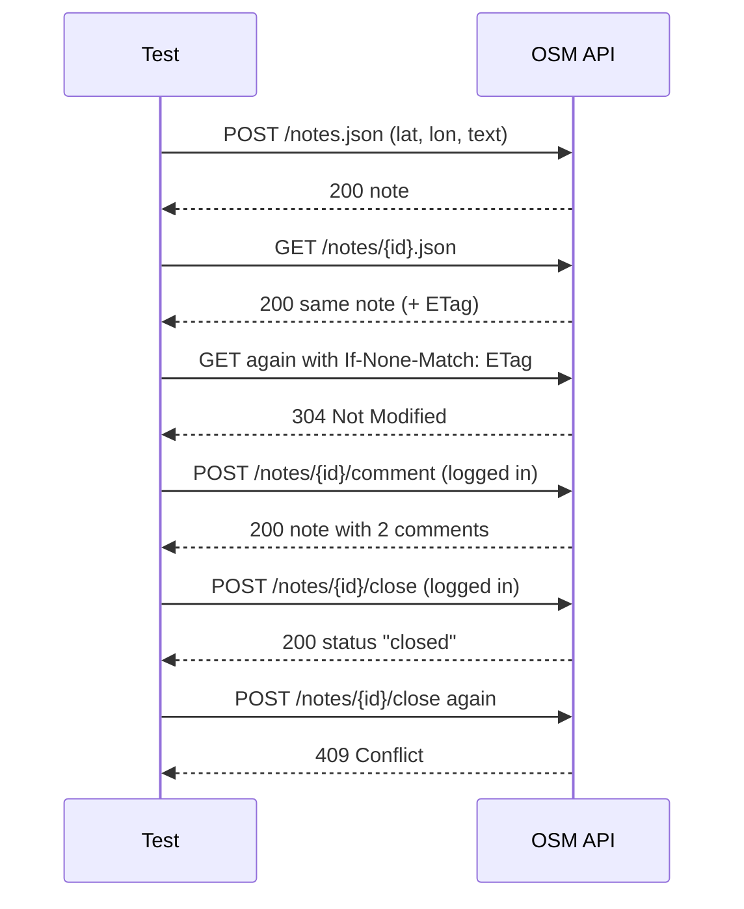
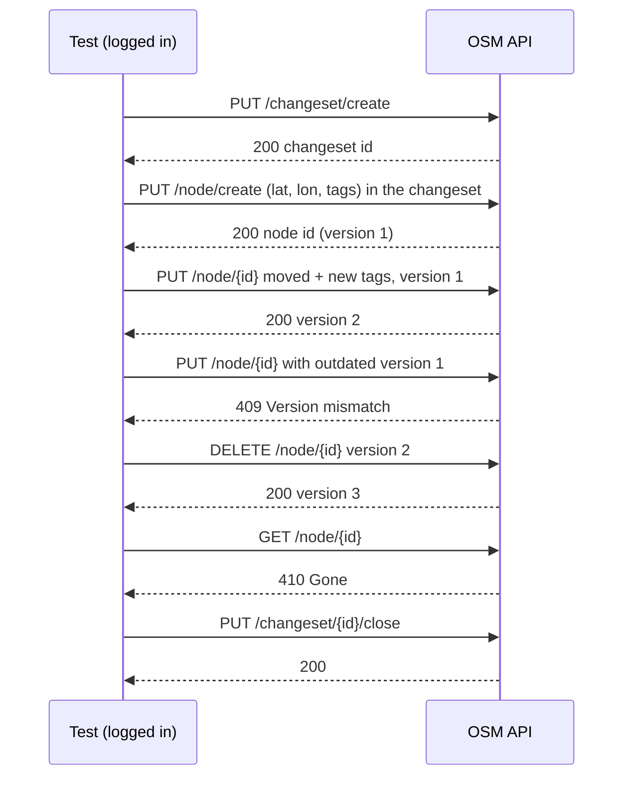

# Test flows and test cases

This document explains **what is tested, how, and with what result**, for the three parts of the project:

1. [An online shop (UI)](#part-1-online-shop-ui): sign in, search, cart and checkout
2. [A map REST API](#part-2-map-rest-api): sending locations to OpenStreetMap
3. [A load test](#part-3-load-test): 1000 users in 15 seconds

It is written for two kinds of readers:

- **If you are not a developer:** read the *flows* (the diagrams and the short text above each table) and the *What we check* and *Expected result* columns. No technical knowledge is needed.
- **If you are a developer:** each test case has an **ID** (e.g. `TC-CART-05`). The same ID is at the start of the automated test's name in the code and in the reports, so you can jump from this document to the code and back. Search for the ID in the repository.

## Words used in this document

| Word | Meaning |
|---|---|
| **Test case** | One thing we check, with the steps to do it and the result we expect. |
| **Test flow** | The path a user follows through the application, e.g. "find a product → put it in the cart → pay". Several test cases follow the same flow with small differences. |
| **Automated test** | A program that performs the steps in a real browser (or sends the requests to the API) and checks the results by itself. |
| **Expected to fail / known bug** | A test that describes the *correct* behaviour of a feature that is currently broken. It fails today on purpose; that failure is the proof of the bug. Each one links to its bug ticket. |
| **Smoke test** | The most important tests, marked `@smoke`. If they fail, the core of the shop is broken. |
| **API** | A way for programs to talk to a service directly, without a web page. |
| **HTTP status code** | The 3-digit number every web answer starts with: `200` OK, `304` not changed, `400` bad request, `401` not logged in, `403` not allowed, `404` not found, `409` conflict, `410` gone. |
| **Page Object** | A code file that knows how one page of the shop works (where the buttons are), so the tests themselves can read like plain steps. |
| **SQL injection** | An attack where someone types database commands into a form field, hoping the site runs them, e.g. to sign in without knowing the password. |

## Scope and approach

| | Part 1 – UI | Part 2 – API | Part 3 – Load |
|---|---|---|---|
| **Application** | PrestaShop 9 live demo shop ([demo.prestashop.com](https://demo.prestashop.com/#/en/front)) | OpenStreetMap API 0.6, official **development** server (a sandbox) | QuickPizza ([quickpizza.grafana.com](https://quickpizza.grafana.com)) |
| **Tool** | Playwright + TypeScript, Page Object Model | Playwright (API testing) + TypeScript | k6 |
| **Browsers** | Chromium (Chrome/Edge engine) and WebKit (Safari engine), desktop size | – | – |
| **Test data** | A brand-new customer for every test; the shop is a fresh copy for every run | Notes and points placed at random spots in the ocean near 0°, 0° | – |
| **Reports** | Allure report (UI and API together), plus Playwright's HTML report with a screenshot, video and trace of every failed test | same | k6 HTML dashboard and end-of-test summary |
| **Runs in** | GitHub Actions on every push and pull request, plus every weekday morning; GitLab CI on every push and merge request | same | GitHub Actions or GitLab CI, on demand |

Why these choices:

- **Why the PrestaShop demo:** of the suggested shops, OpenCart's demo is behind a "verify you are human" check that automation must not bypass. Demoblaze has no search box, so "search by three criteria" would not be possible. PrestaShop has keyword search, categories and filters, plus a complete checkout that uses "bank wire" or "check" payment, so no card details are ever entered.
- **A fresh shop for every run:** the demo creates a temporary shop per visitor. Before any test runs, the suite waits until that shop answers correctly ([BUG-007](../bugs/BUG-007.md) explains why). So every run starts from the same clean data.
- **A new customer per test:** tests can run in parallel without sharing a cart or orders.

**Out of scope:** the shop's back office (admin), real payments, emails, mobile screen sizes, Firefox (left out on request), visual or layout comparison, and security testing beyond a basic SQL injection check of the sign-in form (TC-LOGIN-13).

---

# Part 1: Online shop (UI)

## Flow 1 – Sign in and account

A visitor creates an account, or signs in with an existing one. Once signed in, their name appears at the top of every page. After signing out, the account pages are locked again.

| ID | What we check | Steps | Expected result | Priority | Result |
|---|---|---|---|---|---|
| TC-LOGIN-01 | A registered customer can sign in | 1. Open **Sign in**. 2. Enter the email and password of an existing account. 3. Click **Sign in**. | The customer's name is shown in the header, **Sign in** disappears, and the sign-in page is left. | Smoke | ✅ Pass |
| TC-LOGIN-02 | A wrong password is refused | Sign in with an existing email and a wrong password. | Message **"Authentication failed."**; the user stays on the sign-in page and is not signed in. | High | ✅ Pass |
| TC-LOGIN-03 | An unknown email is refused | Sign in with an email that has no account. | Message **"Authentication failed."**; not signed in. | High | ✅ Pass |
| TC-LOGIN-04 | An empty form is not sent | Click **Sign in** without filling anything in. | The browser marks the email as required; nothing is sent and no server error appears. | Medium | ✅ Pass |
| TC-LOGIN-05 | An email in the wrong format is refused | Enter `not-an-email` and any password, click **Sign in**. | The browser reports an invalid email address; not signed in. | Medium | ✅ Pass |
| TC-LOGIN-06 | Email is not case-sensitive | Sign in with the account's email in CAPITAL letters. | Signed in (emails are case-insensitive). | Low | ✅ Pass |
| TC-LOGIN-07 | The password is hidden and can be shown | Type a password, then click the "eye" button. | Hidden as dots at first; shown as text after the click. | Low | ✅ Pass |
| TC-LOGIN-08 | Sign out works and locks the account | Sign in, open the account menu, click **Sign out**, then open the *My account* address directly. | **Sign in** is visible again; opening *My account* sends the user to the sign-in page. | Smoke | ✅ Pass |
| TC-LOGIN-09 | A new visitor can create an account | Open **Create an account**, fill in title, names, a new email and a password, accept terms and privacy, click **Create account**. | The account exists and the user is signed in straight away (name in header). | High | ✅ Pass |
| TC-LOGIN-10 | The same email cannot be used twice | Try to create an account with an email that already has one. | Message **"The email is already used, please choose another one or sign in"**; no new account. | High | ✅ Pass |
| TC-LOGIN-11 | A birth date in the future gets a clear message | Create an account with birth date `12/31/2099` (correct format, future date). | Account not created, and the message explains the date is in the future. | Low | ❌ Known bug [BUG-004](../bugs/BUG-004.md): message says *"Format should be 05/31/1970."* |
| TC-LOGIN-12 | A valid birth date is accepted | Create an account with birth date `05/31/1970`. | Account created and signed in. | Low | ✅ Pass |
| TC-LOGIN-13 | SQL injection cannot get around the sign-in | 1. Sign in with the email `x'OR'1'='1@example.com` (still a valid email format, so the form is sent). 2. Sign in with an existing email and the password `' OR '1'='1' -- `. | Both refused with **"Authentication failed."**, like any wrong sign-in; no server error, no database message on the page, not signed in. | High | ✅ Pass |

## Flow 2 – Finding products (three search criteria)

The shop offers three different ways to narrow down products, and each is tested:

1. **Keyword:** type a word in the search box.
2. **Category:** pick a category from the menu, e.g. *Clothes › Men*.
3. **Attributes:** filter a category by size or colour, and sort the results by price or name.

| ID | What we check | Steps | Expected result | Priority | Result |
|---|---|---|---|---|---|
| **Criterion 1 – keyword** | | | | | |
| TC-SEARCH-01 | Search finds the right products | Type `mug` in the search box and press Enter. | Heading *Search results for "mug"*; 5 products, each with "mug" in its name; the count shown ("There are 5 products") matches the list. | Smoke | ✅ Pass |
| TC-SEARCH-02 | Suggestions appear while typing | Slowly type `notebook` in the search box. | A drop-down shows the 3 notebooks before Enter is pressed. | Medium | ✅ Pass |
| TC-SEARCH-03 | Upper/lower case does not matter | Search `mug`, then `MUG`. | Exactly the same products. | Low | ✅ Pass |
| TC-SEARCH-04 | A word that matches nothing gives "no results" (run with `qqqq` and `asdfgh`) | Search a nonsense word. | Heading *No search results for "…"*, no products. | High | ❌ Known bug [BUG-001](../bugs/BUG-001.md): unrelated products are shown |
| **Criterion 2 – category** | | | | | |
| TC-SEARCH-05 | A sub-category shows only its products | Main menu: open **Clothes**, click **Men**. | Page *Men*, breadcrumb includes *Clothes*, only *Hummingbird printed t-shirt* is listed. | Smoke | ✅ Pass |
| TC-SEARCH-06 | A category shows exactly what it announces | Main menu: **Accessories › Stationery**. | The 3 notebooks are listed and the page says "There are 3 products". | Medium | ✅ Pass |
| TC-SEARCH-07 | A main category includes its sub-categories | Main menu: click **Clothes**. | The t-shirt (Men) and the sweater (Women) are both listed. | Medium | ✅ Pass |
| **Criterion 3 – attributes** | | | | | |
| TC-SEARCH-08 | Filters narrow down the list | Open **Clothes** (2 products). Filter **Size: M** (still 2). Add **Color: Black**. | One product is left (*Hummingbird printed t-shirt*), and the filters appear in the page address so the result can be shared. | Smoke | ✅ Pass |
| TC-SEARCH-09 | Sorting by price works both ways | Open **Accessories**, sort *Price, low to high*, then *Price, high to low*. | Prices go up, then down. | Medium | ✅ Pass |
| TC-SEARCH-10 | Sorting by name works | Open **Accessories**, sort *Name, A to Z*. | Names are in alphabetical order. | Low | ✅ Pass |
| TC-SEARCH-11 | Each product's picture is described correctly | Open **Clothes › Women** and compare the product title with its picture description. | Same product name in both. | Low | ❌ Known bug [BUG-005](../bugs/BUG-005.md) |

## Flow 3 – Shopping cart

| ID | What we check | Steps | Expected result | Priority | Result |
|---|---|---|---|---|---|
| TC-CART-01 | A product is added with the chosen options | Open *Hummingbird printed t-shirt*, choose size **M**, colour **Black**, quantity **2**, click **Add to cart**. | Pop-up confirms the product was added, shows *Size: M*, *Color: Black* and "There are 2 items in your cart"; header shows 2. | Smoke | ✅ Pass |
| TC-CART-02 | Add to cart from the search results | Search `mug`, click **Add to cart** on *Mug The best is yet to come*. | Pop-up confirms; header shows 1. | Medium | ✅ Pass |
| TC-CART-03 | The total is the sum of the products | Add a mug (€14.28), then a notebook (€15.48), open the cart. | 2 lines, "2 items", total **€29.76**. | High | ✅ Pass |
| TC-CART-04 | The cart is kept when signing in | As a visitor add a mug, then sign in. | The mug is still in the cart; header shows 1. | High | ✅ Pass |
| TC-CART-05 | **+** button updates the totals | In the cart, click **+** next to the mug. | Quantity 2, "2 items", line and cart total €28.56. | High | ✅ Pass |
| TC-CART-06 | Typing a quantity updates the totals | In the cart, type `5` as quantity and press Enter. | "5 items", total €71.40, header shows 5. | Medium | ✅ Pass |
| TC-CART-07 | Removing the last product empties the cart | In the cart, click **Remove**. | Message "…has been removed from the cart", "There are no more items in your cart", total €0.00, **Proceed to checkout** disabled, header shows 0. | Smoke | ✅ Pass |
| TC-CART-08 | Ordering more than is in stock | Type `99999` as quantity. | Message "You can only buy *N* …"; quantity is set to the available stock *N*. | Medium | ✅ Pass |
| TC-CART-09 | A decimal quantity is not inflated | Type `2.5` as quantity; the same test runs again with the decimal comma `2,5`. | Refused or rounded down, never more than typed. | High | ❌ Known bug [BUG-002](../bugs/BUG-002.md): both become **25** |
| TC-CART-10 | A negative quantity is refused | Type `-3` as quantity. | Refused; quantity stays 1. | Medium | ❌ Known bug [BUG-003](../bugs/BUG-003.md): becomes **3** |

## Flow 4 – Checkout

Every checkout test starts with one *Mug The best is yet to come* (€14.28) in the cart.

| ID | What we check | Steps | Expected result | Priority | Result |
|---|---|---|---|---|---|
| TC-CHK-01 | A registered customer can order | Signed in: cart › **Proceed to checkout** › address in Paris › **Click and collect** › **Pay by bank wire** › accept terms › **Place Order**. | "Your order is confirmed"; the customer's email is mentioned; payment *Bank transfer*, shipping *Click and collect*, the mug, total €14.28, an order reference of 9 capital letters. The order appears in the account's **Order history**. | Smoke | ✅ Pass |
| TC-CHK-02 | A guest can order, with paid delivery | Not signed in: **Order as a guest** (name, email, consents) › address › **My carrier** › check the total › **Pay by Check** › accept terms › **Place Order**. | The total includes delivery, **€22.68** (14.28 + 8.40), before and after ordering; confirmation shows the guest's email and *My carrier*. | High | ✅ Pass |
| TC-CHK-03 | The address is required | Guest checkout: click **Continue** on an empty address form. | The step does not move on; *Address*, *Zip/Postal Code* and *City* are reported as missing; *Shipping Method* stays locked. | High | ✅ Pass |
| TC-CHK-04 | A wrong postcode is refused | Guest checkout: enter postcode `ABC12` for France. | Message *Invalid postcode - should look like "NNNNN"*; *Shipping Method* stays locked. | Medium | ✅ Pass |
| TC-CHK-05 | An order needs a payment method and accepted terms | Go to the payment step. Check **Place Order** before and after choosing a payment method, and after accepting the terms. | **Place Order** is disabled until **both** a payment method is chosen and the terms are accepted. | High | ✅ Pass |
| TC-CHK-06 | The bank-wire confirmation tells the customer where to pay | Guest checkout: **Click and collect** › **Pay by bank wire** › accept terms › **Place Order**. Look at **Payment information**. | The amount (€14.28), plus the shop's real account owner, account details and bank name. | High | ❌ Known bug [BUG-006](../bugs/BUG-006.md): all three show `___________` |

---

# Part 2: Map REST API

**Service:** [OpenStreetMap API 0.6](https://wiki.openstreetmap.org/wiki/API_v0.6), on the official development server `master.apis.dev.openstreetmap.org`. It's a public sandbox: nothing created there reaches the real map.

OpenStreetMap offers two ways to "send location information to the map":

- **Notes:** a location plus a message, e.g. "a new bakery opened here". Anyone can create one; commenting, closing or reopening needs a logged-in user.
- **Map data (nodes):** points that become part of the map itself. Every change belongs to a **changeset** (comparable to a "save" with a comment), and editing always needs a logged-in user.

The logged-in tests (marked 🔑) use an **OAuth 2.0 access token** (see the README for how to get one). Until it's configured, those tests are reported as *skipped*, not failed.

## Flow 5 – Notes

| ID | What we check | Request | Expected | Result |
|---|---|---|---|---|
| API-NOTE-01 | A note with a valid location is created | `POST /notes.json?lat&lon&text` | **200**, JSON in the agreed format, coordinates as sent (GeoJSON order: longitude, latitude), status *open*, our text as first comment | ✅ Pass |
| API-NOTE-02 | The note can be read back | `GET /notes/{id}.json` | **200**, same id and location | ✅ Pass |
| API-NOTE-03 | The note is found on the map area | `GET /notes.json?bbox=…` | **200**, the list contains our note | ✅ Pass |
| API-NOTE-04 | The edges of the world are valid (90, 180) and (−90, −180) | `POST /notes.json` | **200** for both corners | ✅ Pass |
| API-NOTE-05 | Special characters are stored safely | Text with `Café 🚲 <b>bold</b> & "quotes"` | **200**; text stored unchanged, HTML shown escaped (no injection) | ✅ Pass |
| API-NOTE-06 | Invalid input is refused (6 cases): latitude > 90, longitude < −180, latitude not a number, latitude missing, text missing, text only spaces | `POST /notes.json` | **400** with a clear message, e.g. *"The note is outside this world"*, *"No text was given"* | ✅ Pass (all 6) |
| API-NOTE-07 | Too large a search area is refused | `GET /notes.json?bbox=0,0,10,10` (100 sq° > limit 25) | **400** *"The maximum bbox size is 25…"* | ✅ Pass |
| API-NOTE-08 | A note that does not exist | `GET /notes/999999999.json` | **404** | ✅ Pass |
| API-NOTE-09 | Errors are reported the way OSM defines them | `POST /notes.json?lat=91…` | **400**, `Content-Type: text/plain`, the message in the body and in the `Error` header | ✅ Pass (JSON errors suggested in [IMP-001](../bugs/IMP-001.md)) |
| API-NOTE-10 | A wrong HTTP method is refused and changes nothing | `PUT /notes/{id}.json` | **404**, as documented for unsupported methods; the note still reads back (200) | ✅ Pass (405 suggested in [IMP-002](../bugs/IMP-002.md)) |
| API-NOTE-11 | Unchanged data is not sent again (caching) | `GET` twice, second with `If-None-Match` | **304**, empty body | ✅ Pass |
| API-NOTE-12 | Caching also works with compression (like browsers) | Same as 11 with `Accept-Encoding: gzip` | **304** | ❌ Known bug [BUG-010](../bugs/BUG-010.md): always 200 |
| API-NOTE-13 | Changed data *is* sent again | Comment on the note, then `GET` with the old ETag | **200** with 2 comments | ✅ Pass 🔑 |
| API-NOTE-14 | Anonymous users cannot change notes | `POST …/comment`, `POST …/close` without login | **401** *"Couldn't authenticate you"*; the note is unchanged | ✅ Pass |
| API-NOTE-15 | A logged-in user can comment | `POST /notes/{id}/comment.json` | **200**, last comment is ours (*commented*) | ✅ Pass 🔑 |
| API-NOTE-16 | Close once, conflict on second close, reopen | `close` › `close` › `reopen` | **200** *closed* › **409** *"The note … was closed at"* › **200** *open* | ✅ Pass 🔑 |
| API-NOTE-17 | Normal users cannot delete notes | `DELETE /notes/{id}.json` | **403** Forbidden; the note still exists | ✅ Pass 🔑 |

## Flow 6 – Map data: the life of a point

| ID | What we check | Request | Expected | Result |
|---|---|---|---|---|
| API-MAP-01 | Anonymous users cannot edit the map | `PUT /changeset/create` without login | **401** | ✅ Pass |
| API-MAP-02 | A point that never existed | `GET /node/999999999999.json` | **404** | ✅ Pass |
| API-MAP-03 | The API reports its status and limits | `GET /capabilities.json` | **200**, API *online*, note-area limit > 0 | ✅ Pass |
| API-MAP-04 | Caching of the capabilities | `GET` with `If-None-Match` | **304** | ✅ Pass |
| API-MAP-05 | Open a changeset | `PUT /changeset/create` | **200**, numeric id | ✅ Pass 🔑 |
| API-MAP-06 | Create a point with tags (a bench) | `PUT /node/create` | **200**, numeric id | ✅ Pass 🔑 |
| API-MAP-07 | Read the point back | `GET /node/{id}.json` | **200**, same location and tags, version 1 | ✅ Pass 🔑 |
| API-MAP-08 | Move and re-tag the point | `PUT /node/{id}` | **200**, version 2; new location and tags are stored | ✅ Pass 🔑 |
| API-MAP-09 | An edit based on an old version is refused | `PUT /node/{id}` with version 1 | **409** *"Version mismatch"* | ✅ Pass 🔑 |
| API-MAP-10 | A point outside the world is refused | `PUT /node/create` lat 95 | **400** | ✅ Pass 🔑 |
| API-MAP-11 | Delete the point | `DELETE /node/{id}`, then `GET` | **200**, then **410** Gone | ✅ Pass 🔑 |
| API-MAP-12 | A closed changeset cannot be used | close, then `PUT /node/create` in it | **200**, then **409** *"The changeset … was closed at"* | ✅ Pass 🔑 |
| API-MAP-13 | Map data can be read with the header `Accept-Encoding: gzip,deflate,br` (no spaces, as Playwright sends it) | `GET /map.json?bbox=…` | **200** | ❌ Known bug [BUG-013](../bugs/BUG-013.md): **406** |

The steps of Flow 6 depend on each other, so they run in order and stop at the first failure. The last step closes the changeset; if an earlier step fails, OpenStreetMap closes it by itself after an hour.

**HTTP status codes covered:**

- Without a token: 200, 304, 400, 401, 404.
- With a token, also: 403, 409, 410.

---

# Part 3: Load test

A separate, detailed report covers the test design, the results, the impact on response time, the optimal response time for modern web apps, and the analysis of HTTP/S responses: **[docs/load-test/README.md](load-test/README.md)**.

In one sentence: **1000 new visitors in 15 seconds had no measurable effect** on QuickPizza's homepage. The median was 138 ms before and 139 ms during the load, with 0% errors.

---

# Latest results

| Suite | Tests | Passed | Known bugs (expected to fail) | Skipped | Failed |
|---|---:|---:|---:|---:|---:|
| UI – Chromium | 42 | 34 | 8 | 0 | 0 |
| UI – WebKit | 42 | 34 | 8 | 0 | 0 |
| API (with token) | 36 | 34 | 2 | 0 | 0 |
| API (without token) | 36 | 22 | 2 | 12 | 0 |
| Load test thresholds | 4 | 4 | – | – | – |

Bugs found: **11**, plus **2** improvement suggestions. See the [bug list](../bugs/README.md).

# Coverage at a glance

| Area | Where |
|---|---|
| Login | Flow 1, TC-LOGIN-01…13 |
| Product search by keyword, category and attributes | Flow 2: keyword (TC-SEARCH-01…04), category (05…07), attributes (08…11) |
| Adding products to the cart | Flow 3, TC-CART-01…10 |
| Checkout process | Flow 4, TC-CHK-01…06 |
| HTML reports | Allure report of UI and API together (`npm run report`), Playwright HTML reports for debugging (`npm run report:ui`, `npm run report:api`), and the k6 HTML dashboard |
| Bug tickets | [`bugs/`](../bugs/README.md): 11 bugs (BUG-001…007, 010…013) and 2 improvement suggestions (IMP-001, 002) |
| Test flows and test cases | this document |
| CI | [`.github/workflows/ci.yml`](../.github/workflows/ci.yml) (GitHub Actions) and [`.gitlab-ci.yml`](../.gitlab-ci.yml) (GitLab CI) |
| API: create, modify, delete data | Notes (API-NOTE-01, 15, 16) and nodes (API-MAP-05…12) |
| API: valid, invalid and edge-case locations | API-NOTE-01…08, API-MAP-10 |
| API: response codes checked | 200, 304, 400, 401, 404 (+ 403, 409, 410 with a token) |
| Load test: homepage response time before and during 1000 users in 15 s | Part 3 |
